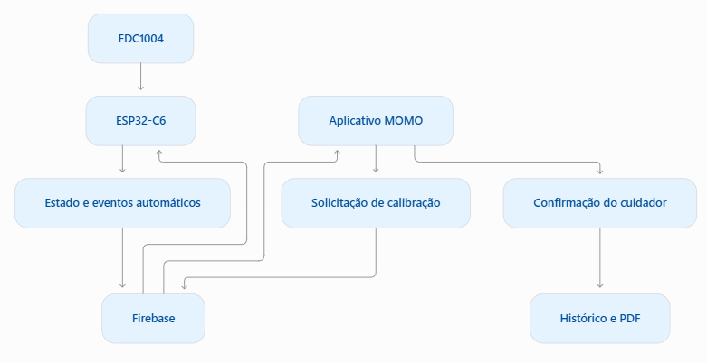
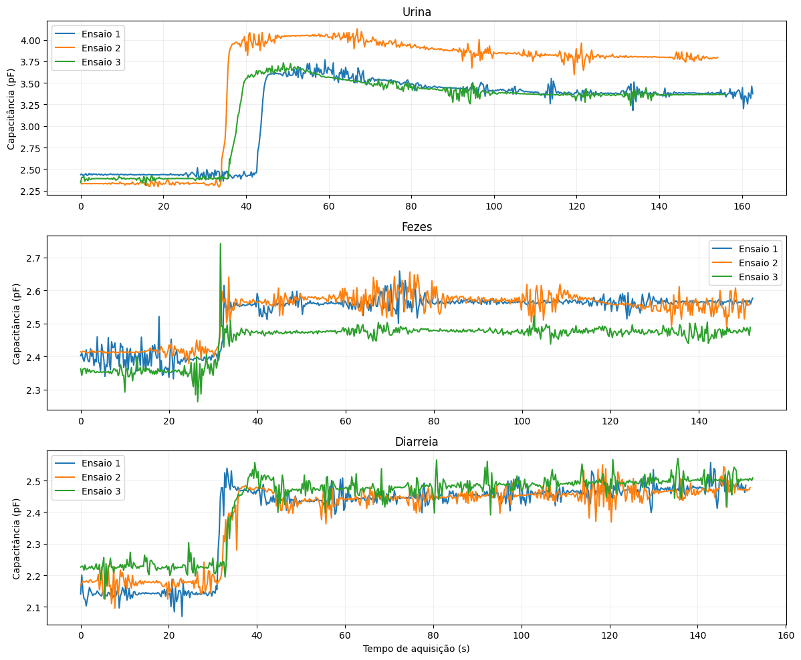
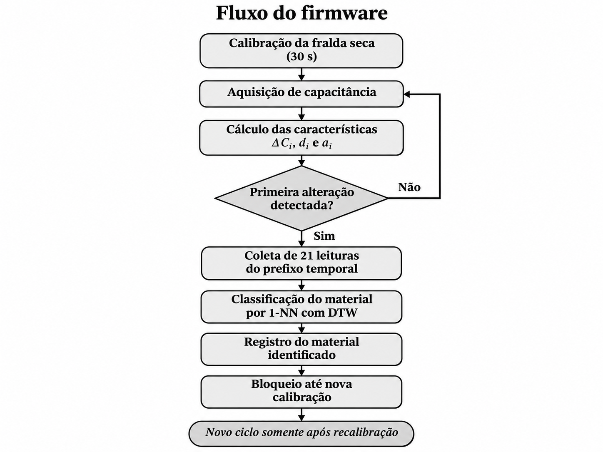
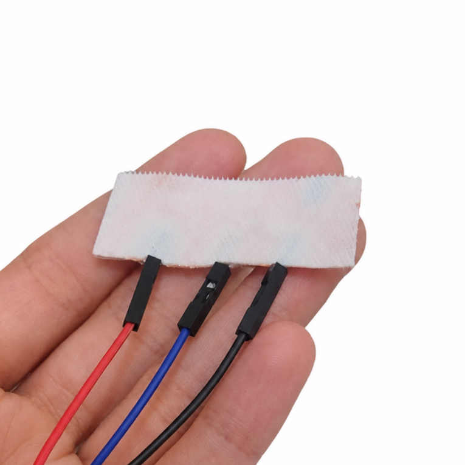
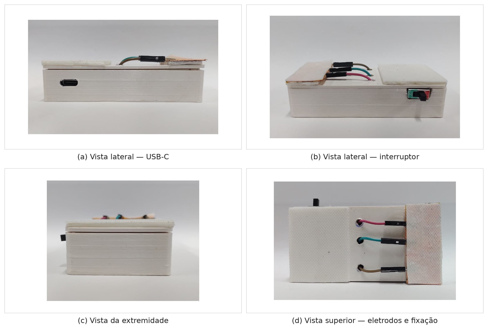
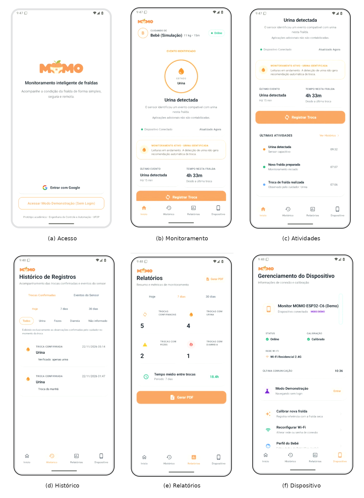

# Sistema inteligente para monitoramento de umidade em fraldas infantis por sensoriamento capacitivo e acesso remoto

**Helen Borges de Lima Souza**  
Trabalho de Conclusão de Curso em Engenharia de Controle e Automação  
Universidade Federal de Ouro Preto (UFOP) · Escola de Minas · 2026  
**Orientadora** Profa. Dra. Adrielle C. Santana · **Coorientador** Prof. Me. João Carlos Vilela de Castro

A verificação das condições de uma fralda depende, em grande parte, da observação direta do cuidador. A partir dessa necessidade, este trabalho desenvolveu um protótipo que acompanha variações de capacitância na fralda e disponibiliza informações em um aplicativo Android. Em bancada, foram utilizados materiais que simulam urina, fezes e diarreia para investigar a identificação dessas condições.

## Funcionamento do sistema

O eletrodo capacitivo é posicionado externamente à fralda. A presença do material modifica a resposta capacitiva, medida pelo **FDC1004** e transmitida por I²C ao **XIAO ESP32-C6**. O microcontrolador processa o sinal e envia o estado do dispositivo e a identificação obtida ao **Firebase Realtime Database**. O aplicativo recebe essas informações e permite que o cuidador registre sua própria observação.

 Fluxo de comunicação entre os subsistemas.

## Ensaios experimentais

Na montagem em protoboard, os ensaios de **caracterização** observaram a resposta capacitiva na presença dos materiais, incluindo aplicações sucessivas na caracterização da urina. Os ensaios de **resposta temporal** partiram da fralda seca e acompanharam o sinal antes e depois de uma única aplicação. Foram realizadas três repetições temporais por material, com intervalo nominal de 250 ms e 120 s de acompanhamento após a aplicação.

 Respostas capacitivas dos materiais nos nove ensaios temporais.

## Detecção e classificação

A investigação começou com o **método dos mínimos quadrados (MMQ)**, que utilizou características calculadas após a aplicação. Em seguida, foi investigada uma estratégia para identificar o material mais cedo. A **Random Forest** detecta a primeira alteração no sinal após a calibração. A partir desse instante, o firmware reúne **21 leituras** e compara o trecho com assinaturas experimentais por **1-NN com Dynamic Time Warping (DTW)**.

Na avaliação exploratória por exclusão de ensaios completos, o MMQ obteve 9 acertos nos 9 registros temporais. A estratégia Random Forest + 1-NN com DTW obteve 13 classificações corretas em 15 registros de aplicação única, com seleção do comprimento do prefixo no treino de cada rodada. Esses resultados dizem respeito aos conjuntos avaliados. No dispositivo, o modelo exportado emprega o prefixo fixo de 21 leituras.

 Sequência de detecção e classificação no firmware.

## Construção do protótipo

O circuito foi inicialmente montado em protoboard para permitir ajustes durante os ensaios. A partir dessa montagem, foi desenvolvida uma placa de circuito impresso dedicada para acomodar o conversor, o microcontrolador e as conexões do eletrodo. O invólucro impresso em 3D abriga a placa e a bateria e mantém acessíveis o interruptor e o conector USB-C.

 Eletrodo capacitivo desenvolvido para posicionamento externo à fralda.

 Vistas do protótipo montado.

## Aplicativo e identidade visual

O aplicativo foi desenvolvido para acompanhar o estado da fralda e orientar sua verificação. A configuração inicial usa a rede Wi-Fi temporária do dispositivo. Durante o monitoramento, o aplicativo recebe os dados pelo Firebase e distingue as detecções do sensor das trocas confirmadas pelo cuidador. O histórico de trocas pode ser consultado no aplicativo e exportado em PDF.

 Principais telas do aplicativo Android.

O nome **MOMO** vem da palavra japonesa para pêssego. A fruta foi associada à delicadeza da pele infantil e combinada com a figura de uma fralda. O símbolo e a paleta de cores orientaram a composição das telas.

 Identidade visual desenvolvida para o aplicativo.

## Ensaios funcionais do sistema integrado

A comunicação entre o dispositivo, o Firebase e o aplicativo foi implementada e observada nos testes funcionais. Em quatro aplicações documentadas, três materiais foram identificados corretamente e uma aplicação de diarreia foi classificada como urina. Em uma ocorrência separada, o dispositivo indicou fezes com a fralda seca. O aplicativo apresentou as indicações do dispositivo e permitiu consultar as confirmações de troca no histórico e em PDF.

Durante os testes, o mau contato, as perdas de leitura e as oscilações com a movimentação dificultaram a aquisição contínua. Os registros disponíveis não permitem atribuir os erros a uma causa específica nem estimar a confiabilidade do sistema em uso. Os resultados são de bancada e o protótipo não foi validado para uso infantil.

## Materiais para consulta

| Etapa do trabalho | Arquivos |
| --- | --- |
| Aquisição experimental | [Programas de aquisição](aquisicao/sketches/) · [18 registros experimentais](aquisicao/dados/ensaios%285%29/) · [Procedimento de coleta](aquisicao/) |
| Investigação dos classificadores | [MMQ em Python](algoritmos/mmq/) · [Random Forest + 1-NN com DTW em Python](algoritmos/rf_dtw/) · [Como reproduzir as análises](algoritmos/) |
| Processamento embarcado | [Firmware e modelo exportado](firmware/momo_embarcado/) · [Montagem e configuração](firmware/) |
| Acompanhamento remoto | [Projeto Android](aplicativo/momo/) · [Regras do Firebase Realtime Database](aplicativo/firebase/firebase_realtime_rules_prototipo.json) |

Figuras de autoria própria, reproduzidas da monografia (2026).
